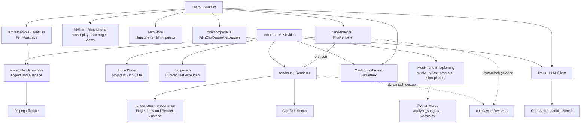
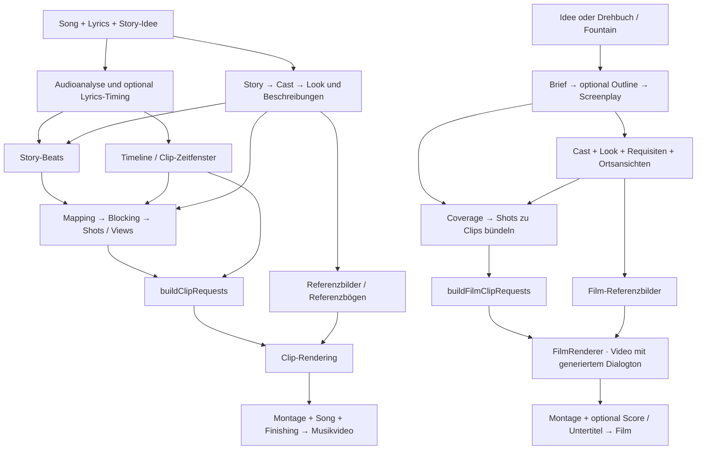
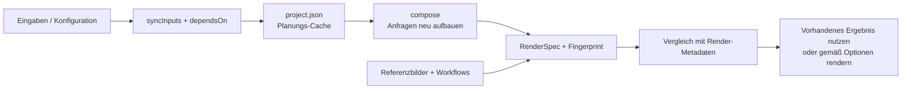

# Codemap: FeverSlop TS / storymaker

Stand: 26.10.2026. Grundlage: aktueller Checkout, TypeScript-AST der Git-versionierten Dateien und Prüfung der Einstiegspunkte, Stores und Renderer.

Das Repository ist eine **Bun-CLI-Anwendung mit zwei fachlichen Pipelines**: Musikvideo und Kurzfilm. Es ist kein Frontend/Backend-System. Die Module unten sind fachliche Gruppen von Dateien, keine getrennt veröffentlichten Packages. `lib/` enthält sowohl Musikvideo-Logik als auch gemeinsam genutzte Infrastruktur; `lib/film/` ergänzt die Film-Logik.

## Architekturübersicht

Pfeile bedeuten „nutzt / ruft auf“, nicht zeitliche Reihenfolge. Die Grafik aggregiert die wichtigsten Verbindungen; Logging und Konfiguration sind aus Gründen der Lesbarkeit zusammengefasst.

Die Kante `film/assemble → Ausgabe` steht konkret für importierte Hilfen aus `lib/assemble.ts`; `film.ts` ruft `final-pass.ts` zusätzlich direkt auf. Die fachlichen Planungsmodule bauen Prompts und verarbeiten Antworten; überwiegend die Einstiegspunkte führen die LLM-Aufrufe aus.

## Module und Zuständigkeiten

| Modul | Zentrale Dateien | Verantwortung und Beziehungen |
|---|---|---|
| Orchestrierung | `index.ts`, `film.ts` | Argumente, Eingaben, Reihenfolge, bedingte Schritte, Review, Rendern und Export. Hier laufen die Teilmodule zusammen. |
| Musik und Timing | `lib/music.ts`, `lib/lyrics.ts`, `lib/frames.ts` | Audioanalyse, Stems, Transkript, Lyrics-Ausrichtung, Clip-Zeitfenster und Zuordnung von Story-Beats; startet Python und ffmpeg. |
| Musikvideo-Planung | `lib/prompts.ts`, `lib/shot-planner.ts`, `lib/shot-plan.ts`, `lib/styles.ts` | Story, Cast, Look, Blocking und Kamera; Parser und strukturierte Planungsdaten. |
| Musikvideo-Komposition | `lib/compose.ts`, `lib/refs.ts`, `lib/playing-check.ts`, `lib/prop-check.ts`, `lib/gender-check.ts` | Aus Plan, Timing, Referenzen und Performance-Angaben entstehen konkrete Clip-Anfragen; Konsistenzprüfungen. |
| Filmplanung | `lib/film/screenplay.ts`, `prompts.ts`, `coverage.ts`, `views.ts`, `types.ts`, `json.ts`, `names.ts`, `shot-checks.ts` | Idee/Drehbuch zu Szenen, Dialogen, Cast, Requisiten, Shots und Clips; filmbezogene Antwortaufbereitung. |
| Film-Import und Komposition | `lib/film/fountain-import.ts`, `fountain.ts`, `compose.ts`, `pictures.ts` | Fountain lesen/schreiben, Referenzbilder auswählen, Film-Clip-Anfragen inklusive Dialog erzeugen. |
| Planungszustand | `lib/project.ts`, `lib/inputs.ts`, `lib/film/store.ts`, `lib/film/inputs.ts`, `lib/partials.ts` | Zwei eigene Stores; Schrittresultate in `project.json`, Eingabe-Fingerprints, transitive Invalidierung und Fortsetzen pro Element. |
| LLM-Zugriff | `lib/llm.ts`, `lib/describe-picture.ts` | OpenAI-kompatible API, Streaming, strukturierte Antworten, Reparatur, parallele Aufrufe und Vision. Prompts bleiben in den Fachmodulen. |
| Rendering | `lib/render.ts`, `lib/film/render.ts`, `lib/batch.ts`, `lib/sequenceSheet.ts` | Serverauswahl, Job-Ausführung, Upload/Download, Bilder, Referenzbögen, Clips, Wiederaufnahme und Clip-Ketten. `FilmRenderer` erweitert `Renderer`. |
| ComfyUI-Anbindung | `comfy/helpers.ts`, `comfy/h3-two-pass.ts`, `comfy/workflows/*.ts` | Typisierte Workflow-Graphen für Krea/Kroma-Bilder, H3-Videos, Yue2-Songs, Referenzbögen und Interpolation. Workflow wird nach Konfiguration dynamisch geladen. |
| Render-Gültigkeit | `lib/render-spec.ts`, `lib/provenance.ts`, `lib/render-state.ts` | Erwarteten Render aus seinen Eingaben beschreiben, Fingerprints mit Metadaten vergleichen, fehlende/veraltete Ergebnisse erkennen. Film ergänzt eigene Clip-Prüfungen. |
| Assets und Casting | `lib/casting.ts`, `lib/library.ts`, `lib/asset-import.ts` | Rollen auf lokale oder Bibliotheks-Assets abbilden; Bilder und Referenzbögen kopieren, Provenienz und Pinning bewahren. Beide Pipelines nutzen dies. |
| Postproduktion | `lib/assemble.ts`, `lib/final-pass.ts`, `lib/finish.ts`, `lib/colormatch.ts`, `lib/interpolate.ts`, `lib/leak.ts` | Clips prüfen, zuschneiden, zusammenfügen, Farbe/Look bearbeiten, Frames interpolieren, Referenzbild-Leaks erkennen. |
| Ausgabe | `lib/gallery.ts`, `lib/timeline-export.ts`, `lib/previous-output.ts`; `lib/film/assemble.ts`, `subtitles.ts`, `timeline.ts`, `shotlist.ts` | Finale Videos, Galerie, Editor-Timelines, Untertitel, Shotlisten und Vergleich neuer Clip-Anfragen. |
| Konfiguration und Betrieb | `lib/config.ts`, `lib/settings.ts`, `lib/cli.ts`, `lib/log.ts`, `lib/process.ts`, `lib/lock.ts`, `lib/archive.ts` | Projekt-/Maschinenkonfiguration, CLI-Verhalten, Prozessstarts, Logs, Schreibsperren und Archivierung. Film ergänzt `config.ts`, `archive.ts`, `setup.ts`. |
| Messung und Diagnose | `lib/timings.ts`, `lib/graph.ts`, `lib/stats.ts`, `lib/stats-report.ts`, `lib/stats-view.ts`, `lib/predict.ts` | Laufzeiten, Workflow-/Hardware-Merkmale, Aggregation, Kosten und Zeitprognosen. `graph.ts` analysiert **ComfyUI-Graphen**, nicht den Quellcode. |
| Bedienwerkzeuge | `tools/*.ts`, `lib/wizard.ts`, `lib/project-setup.ts`, `lib/review.ts` | Setup, Projektanlage, Asset-Verwaltung, Status, Inspect, Statistiken, Migration, Review und Entwicklungswerkzeuge. |

## Wie Daten durch das System fließen

Dies ist ein vereinfachter fachlicher Datenfluss. Es ist weder der vollständige Importgraph noch der vollständige `dependsOn`-Graph. Optionale Schritte hängen von Eingaben, Konfiguration und CLI-Flags ab.

Der zentrale Unterschied: Im Musikvideo bestimmt das vorhandene Audio die Zeitstruktur. Im Film bestimmen Szenen, Handlung und Dialog die Clipplanung; das Videomodell erzeugt den Dialogton.

## Zustand, Wiederaufnahme und Neuberechnung

Es gibt zwei unterschiedliche Abhängigkeitsmodelle:

1. **Planung:** `inputs.ts` ordnet geänderte Eingaben Schritten zu. `dependsOn` im jeweiligen Store propagiert `--redo` oder Eingabeänderungen auf abhängige Resultate. `step()` verwendet vorhandene Ergebnisse, `partials.ts` speichert einzelne Antworten eines größeren Schrittes.
2. **Render-Ergebnisse:** `render-spec.ts` und `provenance.ts` bestimmen, aus welchen Prompts, Bildern, Einstellungen und Workflows eine Datei entstand. Ein vorhandenes Video kann deshalb gegenüber dem aktuellen Plan veraltet sein. Die Refresh-/Render-Optionen steuern die erneute Erzeugung.

Projektartefakte liegen in `projects/<id>/`, Filmartefakte in `films/<id>/`: jeweils Eingaben, `project.json`, Assets, Videos und Ausgaben. `library/` stellt wiederverwendbare Assets bereit; Projekte erhalten Kopien. Maschinenkonfiguration und globale Timings liegen standardmäßig außerhalb des Repos. Es gibt keine zentrale Datenbank.

## Architekturbeobachtungen

- **Getrennte Fachlogik, gemeinsame Ausführung:** Die Trennung von Musikvideo und Film betrifft vor allem Planung und Zustand. `lib/film/render.ts:67` deklariert `FilmRenderer extends Renderer`. Außerdem importiert Film gemeinsame Kompositionskonstanten, Assembly-Hilfen, Prompts, Casting und Finishing. Der einleitende Kommentar in `film.ts`, der nur LLM, Settings und Helpers als gemeinsam nennt, ist enger als der aktuelle Code.
- **Große Integrationspunkte:** `index.ts` hat 1.440 Textzeilen, `lib/compose.ts` 1.015, `lib/render.ts` 989 und `film.ts` 675, jeweils inklusive Kommentaren und Leerzeilen. Hier bündeln sich Ablauf-, Kompositions- und Renderentscheidungen. Änderungen benötigen entsprechend Kontext über mehrere Teilmodule; Dateigröße allein ist kein Fehlernachweis.
- **Keine gefundenen statischen Laufzeit-Importzyklen:** Die AST-Auswertung der 111 versionierten Produktionsdateien findet 489 lokale Import-/Reexport-Deklarationen, davon 410 mit Laufzeitanteil. Rein typbezogene Kanten sind ausgeschlossen. Dynamische Workflow-Imports und Prozessaufrufe sind nicht Teil dieser Zyklusprüfung.
- **Workflow-Auswahl ist eine Laufzeit-Verbindung:** `lib/render.ts` und `lib/film/render.ts` laden Workflow-Dateien mit `import(join(workflowDir, ...))`. Eine reine statische Importgrafik würde diese wichtige Verbindung unterschlagen.
- **Explizite Invalidierung ist eine Pflegepflicht:** Wenn ein Schritt zusätzliche Daten liest, muss sein `dependsOn`-Eintrag mitwachsen. Der TypeScript-Importgraph kann diese fachliche Abhängigkeit nicht automatisch ersetzen.
- **Breit genutzte Basis:** `log.ts` hat 49 verschiedene Produktions-Importer, `cli.ts` 22, `frames.ts` und `comfy/helpers.ts` jeweils 19. Das zeigt Reichweite, keine automatische Fehlkopplung.

## Einstieg nach Änderungsziel

| Ziel | Zuerst lesen |
|---|---|
| Ablauf oder neuen Musikvideo-Schritt ändern | `index.ts` → `lib/project.ts` → `lib/inputs.ts` |
| Shotplanung / Promptqualität ändern | `lib/shot-planner.ts` → `lib/shot-plan.ts` → `lib/compose.ts` |
| Drehbuch / Filmdialog ändern | `film.ts` → `lib/film/screenplay.ts` → `lib/film/coverage.ts` → `lib/film/compose.ts` |
| Rendering / neuen Workflow ändern | `lib/render.ts` → `lib/film/render.ts` → `comfy/helpers.ts` → `comfy/workflows/` |
| Fälschlich aktuelle / veraltete Ergebnisse untersuchen | `lib/render-spec.ts` → `lib/provenance.ts` → `lib/render-state.ts` |
| Casting / Bibliothek ändern | `lib/casting.ts` → `lib/library.ts` → `lib/asset-import.ts` |
| Timing / Synchronität untersuchen | `lib/music.ts` → `lib/lyrics.ts` → `lib/frames.ts` → `lib/assemble.ts` |

## Analysebasis und Grenzen

Die Datei `../graphify-out/source-imports.json` enthält den maschinenlesbaren, auf versionierte TypeScript-Produktionsdateien begrenzten Importgraphen. Er lässt sich mit `bun graphify-out/codemap.ts` neu erzeugen. Die Auswertung unterscheidet reine Typ-Imports von Imports mit Laufzeitanteil; Kanten zählen Deklarationen, nicht einzelne importierte Symbole. Die Zeilenzahlen zählen durch Newlines getrennte Textzeilen.

Zusätzlich wurde `graphify build .` ausgeführt. Dessen breiter Scan meldet 8.439 Dateien, 4.797 Symbole und 4.648 Beziehungen und liegt in `../graphify-out/graph.json`. Diese Dateizahl ist **keine Anzahl der Repository-Quellmodule**: der Scan umfasst auch lokale, nicht versionierte Inhalte. Für die Zahlen und Abhängigkeiten dieser Codemap ist deshalb die eingegrenzte TypeScript-AST-Auswertung maßgeblich.

Es gibt 46 versionierte TypeScript-Testdateien sowie zwei Python-Werkzeuge. Die Tests liegen überwiegend neben dem Code; Golden-Tests in `lib/golden.test.ts` prüfen auch gemeinsame Render-/Workflow-Verträge. Diese Codemap ist eine statische Untersuchung: Es wurden keine LLM-/ComfyUI-Jobs gestartet und keine Tests ausgeführt. Generierte ComfyUI-Node-Typen, externe Paketimplementierungen und Laufzeit-Projektdateien sind nicht Bestandteil der Importzählung.
