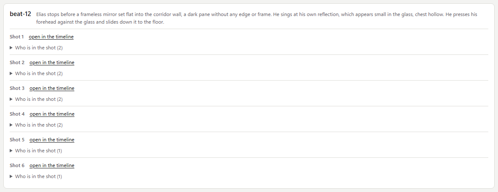
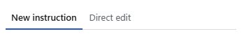
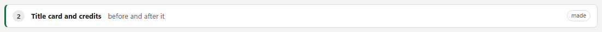
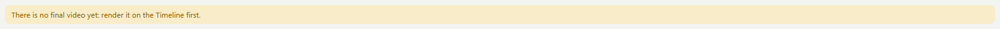
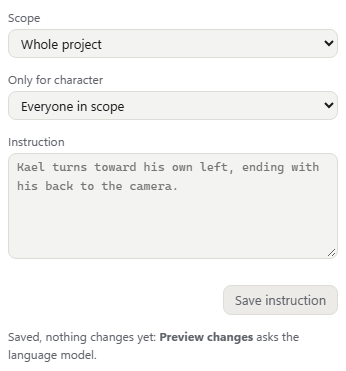
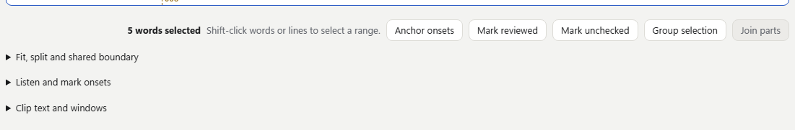
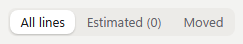
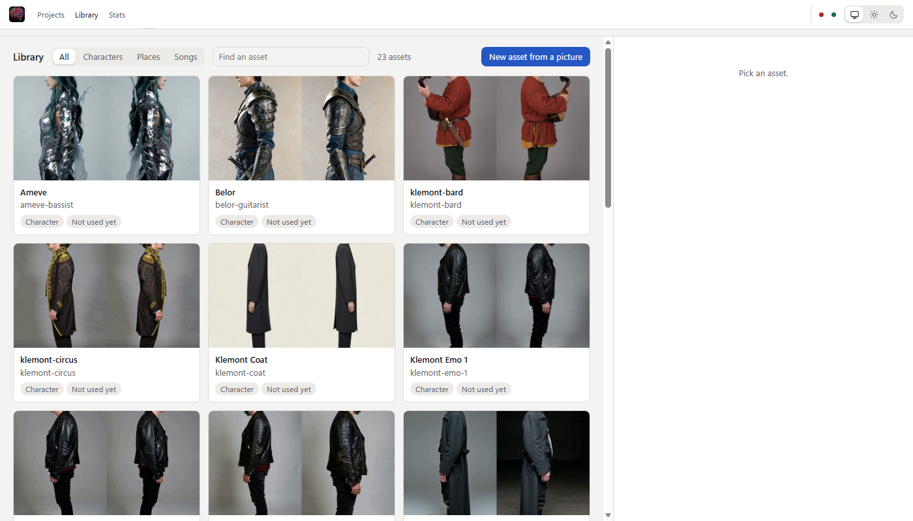

# Design system of the workspace

The workspace's tokens live in `:root` of `client/src/styles/tokens.css`. A stylesheet or a component's `<style>` uses them and no literal values: `client/tests/unit/design-tokens.test.ts` fails on a literal gap, radius or font size. Padding and margin are not checked yet. For them, prefer a step of the space scale too.

## Scales

| Token | Value | For |
| --- | --- | --- |
| `--space-half` | 2 px | between parts of one thing: a crumb and its arrow |
| `--space-1` | 4 px | inside a control, between tags |
| `--space-2` | 8 px | between buttons in a row, between the fields of a group |
| `--space-3` | 12 px | between the parts of a card |
| `--space-4` | 16 px | between cards |
| `--space-5` | 20 px | between the sections of a page |
| `--space-6` | 24 px | around a page |
| `--radius-s` | 4 px | tags, small marks, timeline bars |
| `--radius-m` | 8 px | buttons, fields, cards, dialogs |
| `--radius-pill` | 99 px | chips and pills |
| `--radius-round` | 50 % | dots and round badges |
| `--text-xxs` | 9 px | a letter in a 14 px badge, nowhere else |
| `--text-xs` | 11 px | labels on the timeline, captions |
| `--text-s` | 12 px | notes, secondary text, small buttons |
| `--text-m` | 13 px | body text, the page's default |
| `--text-l` | 15 px | headings of a page or a dialog |

## What a colour means

| Token | Means | Not for |
| --- | --- | --- |
| `--accent` (blue) | the main action of a page (`.btn.primary`), the current tab, focus, a selected item | links, warnings |
| `--plan` (violet) | a button that asks the language model | |
| `--finish` (teal) | a button that finishes the video for publishing | |
| `--danger` (red) | something that removes or stops (`.btn.danger`: Remove, Stop), a failure | a main action |
| `--stale` (amber) | made from an older state, needs doing again | |
| `--ok` (green) | done, reachable | |
| `--text`, underlined | a link (`.link`, a `RouterLink` in text) | |

A disabled button is grey in every variant: `--raised` background, `--muted` text. A faded primary or danger button is never shown.

## Buttons

| Class | Use |
| --- | --- |
| `.btn` | any action |
| `.btn.primary` | the one main action of a page or a dialog |
| `.btn.danger` | removes or stops something |
| `.btn.mini` | small actions inside a row or a note: Use the default, Undo |
| `.link` | a button that reads as a link: an id that jumps somewhere |

The variants stay classes, not a `Button` component (#915): a component would only wrap `<button>` and turn a prop into the same class - the class says it as well, and a `RouterLink` or a `<label>` can carry it too.

## Components

Shared parts live in `client/src/components/`, each with its own scoped styles and a class prefix of its own (`ui-…`). A component's class name without a prefix would take the rules of the stylesheets below: `.card` is the project card, `.item` and `.list` belong to other pages.

| Component | Use | Says |
| --- | --- | --- |
| `PanelCard` | a card of a page: Direction's groups and proposal, Look's whole-look card, Post-work's steps | `title`, `note` (two lines, the whole on hover), slots `head` and `foot`; `tone` = `accent` (to act on), `stale` (to decide), `quiet` (nothing to do); `bar` = `line`, `accent`, `ok`; `flush` for a card its content fills |
| `TabBar` | tabs above a panel: the Direction side, the clip inspector | `tabs` (`id`, `label`, `count`), `v-model`; `inset` in a side panel |
| `StateTag` | a small outlined word about a thing: edit, made, a name | `state` = `plain`, `ok`, `stale`, `bad`; muted without one |
| `CalloutBox` | a boxed word to the reader, in place of `.note`, `.warn`, `.warn.bad` | `kind` = `note` (grey, default), `warn` (amber: check this, do it again), `error` (red: failed); `as` for the element (`p` by default). Its rules stay in `monitor.css`, where `.warn` was, so that a page's margin rules still win |
| `SplitLayout` | a page in two columns, one in a narrow window: Library, References, Singers, Timing (`full`: both columns scroll, the side is a panel), Direction and Post-work (a grid in the page) | default slot and `side` slot; `side` = its width; `full`, `folded` (kept, not unmounted), `sticky`, `side-first` (narrow window), `label`; `main` exposed for a page that looks through its rows |
| `DisclosureBox` | something folded away until asked for: who is in a shot, plan versions, the CLI, the tool groups of Timing | `title`, slot `summary` for more in the head, `v-model:open`; `quiet` (a muted title), `small`. Not for a menu (the run dock's warnings, Timing's Reset ▾) or for Post-work's steps, of which one is open at a time |
| `FormField` | a labelled field in every form | `label`, the control in the slot, `note` under it; `check`: a checkbox and its words in one row |
| `SegmentedControl` | a choice of one among few, as pressed buttons | `options`, `v-model` |

A page says what a card or a tag is (its tone, its state), never how it is drawn: no page has card, tab or tag styles of its own.

### As they look

| | |
| --- | --- |
| `PanelCard` with quiet `DisclosureBox`es |  |
| `TabBar` |  |
| `StateTag` "made" on a card with an `ok` bar |  |
| `CalloutBox` (`warn`) |  |
| `FormField`s in a form |  |
| `DisclosureBox`es |  |
| `SegmentedControl` |  |
| `SplitLayout` (`full`, the Library) |  |

The pictures are taken in the light theme; `bun run editor` shows both.

## Stylesheets

`client/src/styles/workspace.css` only imports the parts, in the order of the cascade: a later file wins over an earlier one.

| File | Holds |
| --- | --- |
| `tokens.css` | the tokens above, both themes |
| `base.css` | html, body, headings, text |
| `shell.css` | the top bar, its tabs and machine, the chips |
| `controls.css` | buttons and fields |
| `monitor.css` | the player and the clip inspector |
| `timeline.css` | the timeline's toolbar, lanes, clips and marks |
| `cards.css` | lists of cards: start page, library, references, casting |
| `casting.css`, `singers.css`, `timing.css` | those pages |
| `run.css` | the run dock |
| `dialogs.css` | dialogs, viewer, compare, toasts, boot screen |
| `narrow.css` | a narrow window and motion, after the rules they change |
| `app.css` | the Vue shell and a project's settings |
| `utilities.css` | the `u-` utilities and the legend's swatches |

A new page's styles go into its component's scoped `<style>`, with a prefix; a rule several pages share goes into the file of its part.
