# Anleitung: der Workspace

Der Workspace zeigt alle Projekte und Filme im Browser. Du siehst ein Video als Ganzes auf einer Timeline und kannst einzelne Teile neu rendern, ohne dass der Plan sich ändert. Diese Anleitung beschreibt die typischen Abläufe, die Beschriftungen stehen so da, wie die Seite sie zeigt. Alle Optionen im Detail stehen in der [README](../README.md#the-workspace).

## Starten

```powershell
bun run editor
```

Dann http://127.0.0.1:4173/ öffnen. Mit `bun run editor <id>` startest du direkt in einem Projekt, `--film` nimmt einen Film, `--port=4174` einen anderen Port. Die Seite ist nur auf diesem Rechner erreichbar. Beim ersten Start, und nach einem Pull, der die Seite geändert hat, baut `bun run editor` sie vorher neu (ein paar Sekunden, dafür braucht es Node.js).

Alles, was rendert, ist die normale CLI: Die Seite startet sie nur. Solange ein Lauf an einem Projekt arbeitet, ist es gesperrt, egal ob du ihn hier oder im Terminal gestartet hast. Einen Lauf aus dem Terminal kannst du hier verfolgen und stoppen.

Drei Dinge gelten überall:

- **Vor jedem Render fragt die Seite nach.** Der Dialog nennt, was passiert, was es ungefähr kostet und welche anderen Clips betroffen sind. Unter **Render on** wählst du die Server. Ohne **Start** oder **Render it** passiert nichts.
- **Alte Fassungen gehen nicht verloren.** Eine ersetzte Fassung wird weggelegt und bleibt auswählbar.
- **`?`** zeigt alle Tasten und erklärt die Begriffe.

## Die wichtigsten Begriffe

| Begriff | Bedeutung |
|---|---|
| **Stale** | Aus einem anderen Prompt, Bild oder Startframe gemacht, als der Plan jetzt hat. Die Datei ist noch brauchbar und wird nur auf deinen Wunsch neu gerendert. |
| **Pinned** | Eigene Datei, geänderter Prompt oder älter als diese Prüfung. Die Pipeline lässt sie in Ruhe. |
| **Goes on** | Der Clip beginnt auf dem letzten Frame des Clips davor. Wird der neu gerendert, passt der Anfang nicht mehr. |
| **Anchor** | Das eine Bild, von dem eine Person oder ein Ort ausgeht. |
| **Sheet** | Das Referenzbild mit mehreren Ansichten, aus einem kurzen Video vom Anchor gemacht. |
| **Take** | Projekte, deren Namen sich nur durch Datum oder Endung unterscheiden. Sie liegen auf der Startseite in einer Karte. |

## Ein Projekt finden

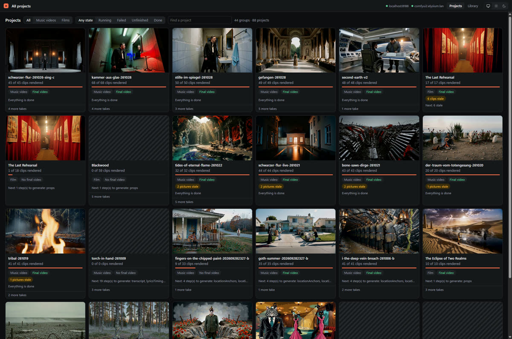

Jede Karte zeigt, wie weit ein Projekt ist und was als Nächstes käme. Oben filterst du nach Art (**Music videos**, **Films**) und Zustand (**Running**, **Failed**, **Unfinished**, **Done**) und suchst über **Find a project**. Oben rechts siehst du, welche Render-Server erreichbar und wie ausgelastet sie sind. Ein Klick auf die Karte öffnet die Timeline.

## Ein Projekt in Stufen planen

Ein neues Projekt planst du am besten so, wie ein Film entsteht: erst das Buch, dann die Besetzung, dann der Look, dann die Einstellungen. Erst danach wird gerendert. So änderst du die Figuren, bevor irgendetwas auf ihnen aufbaut, und lange bevor GPU-Zeit anfällt.

| Stufe | Was entsteht | Wo du es ansiehst |
|---|---|---|
| **Story** (beim Film: **Screenplay**) | die Geschichte aus Songtext und Story-Idee, beim Film das Drehbuch | **Story** |
| **Cast** | Figuren und Orte, beim Musikvideo auch, wer welche Zeile singt | **Casting**, **Singers** |
| **Look** | der Look des Videos, das Aussehen jeder Figur und jedes Orts, auf Wunsch die Bilder dazu | **Look**, **References** |
| **Shot plan** | die Beats auf dem Song und die Einstellungen jedes Clips | **Timeline** |

Oben auf **Story** und **Casting**, und auf der Timeline eines Projekts ohne Clips, steht eine Leiste mit den Stufen. Erledigte Stufen sind abgehakt. Der Knopf rechts plant die nächste Stufe und hält dann an, zum Beispiel **Plan the cast**. **Plan everything** plant ohne Halt bis zu den Einstellungen. Das alles macht nur das Sprachmodell, gerendert wird nichts. Im Terminal geht dasselbe mit `--until=story`, `--until=cast` oder `--until=look`.

**Die Story ändern:** Auf **Story** steht der Text zum Bearbeiten. **Save the story** speichert ihn. Alles, was aus der alten Story geplant war, fällt dabei weg, und der nächste Planlauf macht es neu. **Write it again** lässt das Sprachmodell eine neue Story schreiben. Ein Drehbuch steht hier nur zum Lesen: Es wird im Skript unter `input/` geändert.

**Die Story an den Cast anpassen:** **Tell it anew for the cast** lässt das Sprachmodell dieselbe Story mit der Besetzung erzählen, die **Casting** jetzt hat: gleiche Handlung, gleiche Orte, etwa gleiche Länge. Der Vorschlag erscheint neben der jetzigen Story. **Take the new story** übernimmt ihn, **Drop it** verwirft ihn. Beim Übernehmen bleiben Cast, Sängerwahl und Looks, nur die Zusammenfassung und alles ab den Beats wird neu geplant.

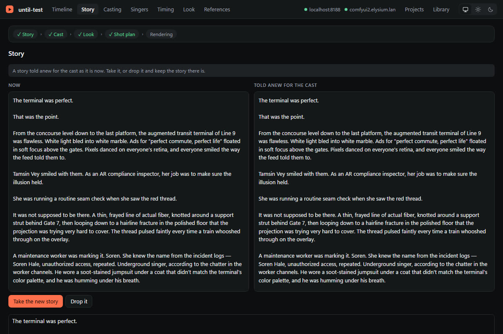

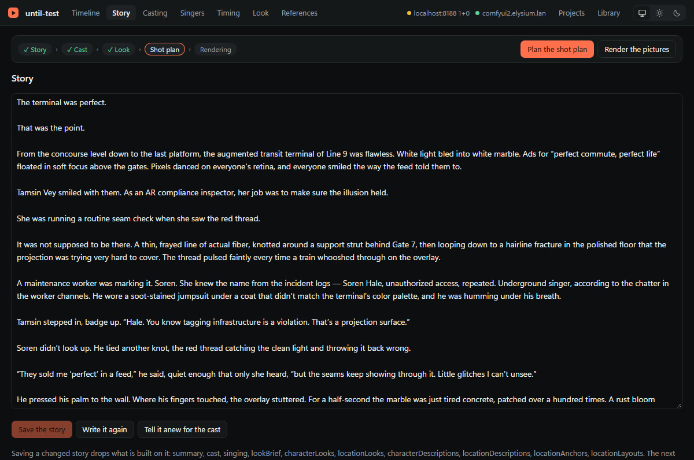

**Den Look ändern:** Auf **Look** steht oben der Look des ganzen Videos, darunter je Figur und Ort der Look (daraus wird das Bild gemacht) und die Beschreibung für die Clip-Prompts, bei Orten auch Hintergrund und Grundriss. Du änderst einen Text von Hand oder setzt den Haken **Write anew**, dann schreibt das Sprachmodell ihn neu. Was aus einem geänderten Text folgt, wird nur für diese eine Figur oder diesen einen Ort neu geschrieben: aus einem neuen Look die Beschreibung, aus einem neuen Ort-Look Beschreibung, Hintergrund und Grundriss. Alle anderen behalten ihre Texte. Nach **Save** fragt die Seite, ob das gleich geschehen soll. Ein geänderter Look des ganzen Videos schreibt dagegen alle Looks neu.

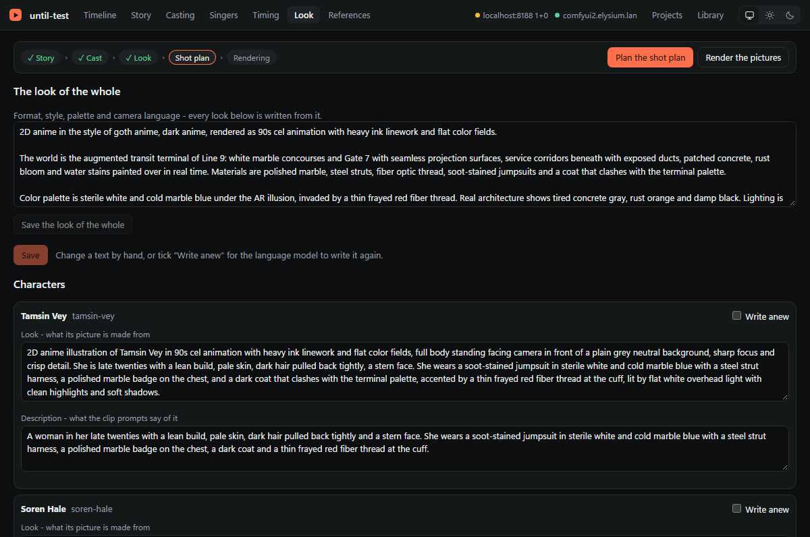

**Casting-Fotos:** Steht der Look, rendert **Render the pictures** die Bilder aller Figuren und Orte, bevor die Einstellungen geplant werden. Auf **References** siehst du sie an, änderst einen Prompt oder renderst ein Bild neu, ohne dass dabei schon die Einstellungen geplant werden. Nur die Mitglieder einer Gruppe kommen erst mit den Einstellungen, denn wie viele es sind, steht erst in den Beats. Im Terminal: `--until=look --render=images`.

**Den Cast ändern:** Siehe [Besetzung und Bibliothek](#besetzung-und-bibliothek). Am besten direkt nach **Plan the cast**: Dann baut noch nichts auf ihm auf.

### Dasselbe im Terminal

Alles aus diesem Abschnitt geht auch ohne Workspace. Die Seiten rufen dieselben Befehle auf. Jeder Befehl gibt ohne Option aus, was da ist. Mit Option ändert er es, nennt, was dabei wegfällt, und schlägt den Planlauf vor, der es neu macht.

| Im Workspace | Im Terminal |
|---|---|
| Stufen-Leiste: **Plan the cast** usw. | `bun index.ts <id> --until=story` (auch `cast`, `look`); Film: `bun film.ts <id> --until=…` |
| **Story** lesen, ändern | `bun run story <id> --out=story.txt`, ändern, dann `bun run story <id> --set=story.txt` |
| **Tell it anew for the cast**, **Take the new story**, **Drop it** | `bun run story <id> --adapt`, dann `--take` oder `--drop` |
| neue Namen in die Story | `bun run story <id> --rename="Soren Hale=Soren Vale"` |
| **Change the cast**, **Add a character**, **Add a place**, **Remove** | `bun run cast <id> --json > cast.json`, ändern, dann `bun run cast <id> --set=cast.json`. Eine neue Figur steht ohne `id` drin, eine entfernte fehlt einfach. |
| Rolle aus der Bibliothek, **Plan now** | `bun run casting <id> --set=character:mara=library:mara-v2`, der Befehl nennt das passende `--redo` |
| Timing: **Put the song into the library…** | `bun run export-song <id> [--as=<song-id>] [--name=<name>]`; in ein Projekt: `bun run import-song <id> <song-id>` |
| **Look** lesen, ändern | `bun run look <id>`; `--json > look.json`, ändern, `--set=look.json` |
| **Write anew** | `bun run look <id> --again=leo,location:hall` |
| **Render the pictures** | `bun index.ts <id> --until=look --render=images` |

Beim Film kommt überall `--film` dazu. Das Drehbuch wird dort nur ausgegeben, und `cast --set` ändert nur Namen und Texte.

Ein Beispiel von vorne bis zu den Casting-Fotos:

```powershell
bun index.ts mein-video --until=cast
bun run cast mein-video --json > cast.json
# cast.json bearbeiten: einen Namen ändern, eine Figur ohne "id" ergänzen
bun run cast mein-video --set=cast.json
bun run story mein-video --adapt
bun run story mein-video --take
bun index.ts mein-video --until=look
bun run look mein-video
bun run look mein-video --again=soren-hale
bun index.ts mein-video --until=look --render=images
bun index.ts mein-video
```

## Ein Video ansehen

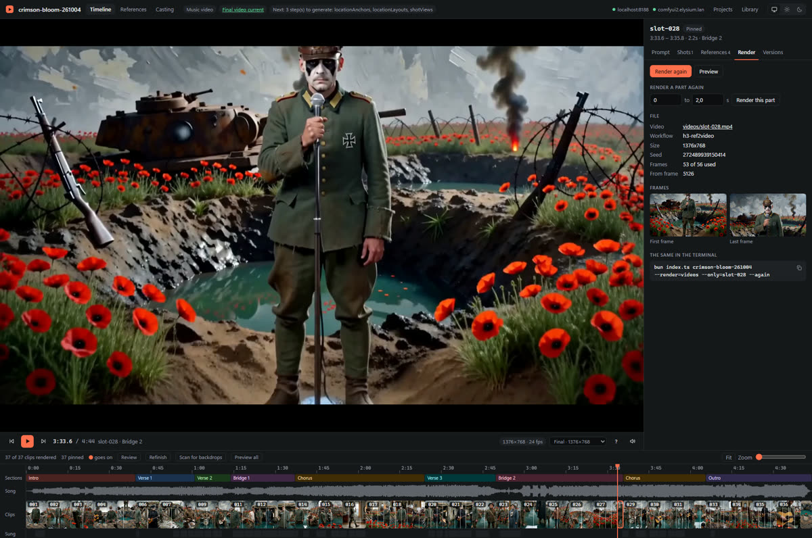

- **Oben links** läuft das Video, **unten** liegt die Timeline mit Abschnitten, Ton, Clips und gesungenen oder gesprochenen Zeilen.
- **Rechts** stehen die Details des gewählten Clips: **Prompt**, **Shots**, **References**, **Render** und **Versions**.
- **Rechts neben der Abspielzeit** wählst du, was läuft: das fertige Video oder **Clips over the song**, also die einzelnen Clips. Zum Beurteilen von Clips nimmst du Letzteres, denn ein fertiges Video zeigt die Clips so, wie sie beim Zusammenbau waren.

Nützliche Tasten: `Leertaste` spielt und pausiert, `←` und `→` springen zum vorigen oder nächsten Clip, `,` und `.` gehen einen Frame zurück oder vor, `O` wiederholt den Clip in Schleife.

Über der Timeline steht, wie viele Clips fehlen oder stale sind. **Only flagged** blendet alle anderen ab, `‹` und `›` springen von einem auffälligen Clip zum nächsten. **Scan for backdrops** sucht ohne GPU nach grauen Studio-Hintergründen in den Clips.

## Einen Clip neu rendern

1. Clip auf der Timeline anklicken.
2. Rechts den Reiter **Render** öffnen.
3. **Preview** ist der billige Test: wenige Schritte, wenige Pixel, in einem eigenen Ordner. Ein echter Clip wird dabei nie ersetzt.
4. **Render again** rendert den ganzen Clip neu. Der Dialog nennt die geschätzte Dauer und warnt, wenn andere Clips auf diesem aufbauen.
5. Nach dem Render öffnen sich alte und neue Fassung nebeneinander.

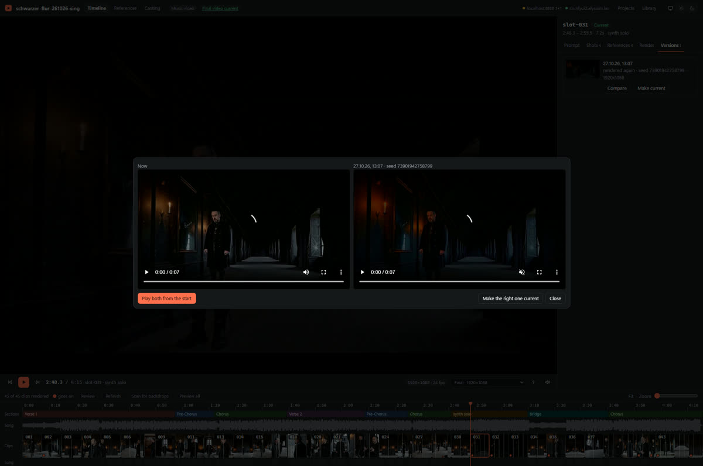

**Play both from the start** spielt beide synchron. Gefällt dir die alte besser, nimmst du **Go back to the old one**. Später geht das im Reiter **Versions** mit **Compare** (das Fenster im Bild, dort heißt der Knopf **Make the right one current**) oder direkt mit **Make current**.

**Im Terminal:** `bun run versions <id> slot-007` listet die weggelegten Fassungen eines Clips, die neueste zuerst. `--pick=<Fassung>` macht eine davon wieder aktuell. Das geht genauso für Bilder (`bun run versions <id> mara`). Die aktuelle Fassung wird dabei weggelegt und bleibt auswählbar. Beim Film kommt `--film` dazu. Die eigene Wahl eines Film-Clips (Ansicht, Referenzen) setzt `bun run override <film-id> clip-007 --view=2 --without=<bild>`, `--clear` nimmt sie zurück.

### Nur einen Teil neu rendern

Ist nur eine Stelle schlecht, gibst du im Reiter **Render** unter **Render a part again** die Sekunden an und klickst **Render this part**. Hat der Clip mehrere Shots, gibt es dafür je einen Knopf. Der übrige Clip bleibt erhalten, das fertige Video wird dabei nicht neu zusammengebaut.

> **Vorsicht:** Das ist noch nicht erprobt. Auf der Radeon lief dieser Job in den Speicherfehler, und ein Versuch hat den Server abstürzen lassen. Bei einem Film geht ein Teil mit Dialog nicht, weil der Ton dort am Bild hängt.

## Mehrere Clips auf einmal

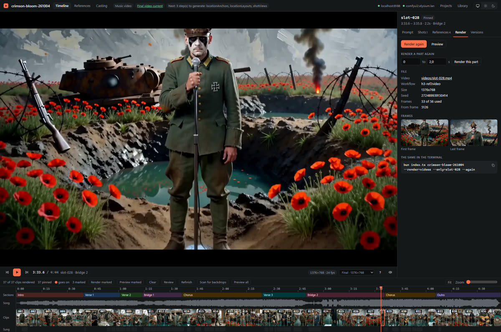

1. Mit `Strg`+Klick markierst du einzelne Clips, mit `Umschalt`+Klick alle bis zu diesem Clip. **Mark flagged** markiert alle auffälligen.
2. Über der Timeline erscheinen **Render marked**, **Preview marked** und **Clear**.
3. Während des Laufs zeigt jeder Clip auf der Timeline, ob er wartet, rendert oder fertig ist.

## Clips durchgehen und entscheiden

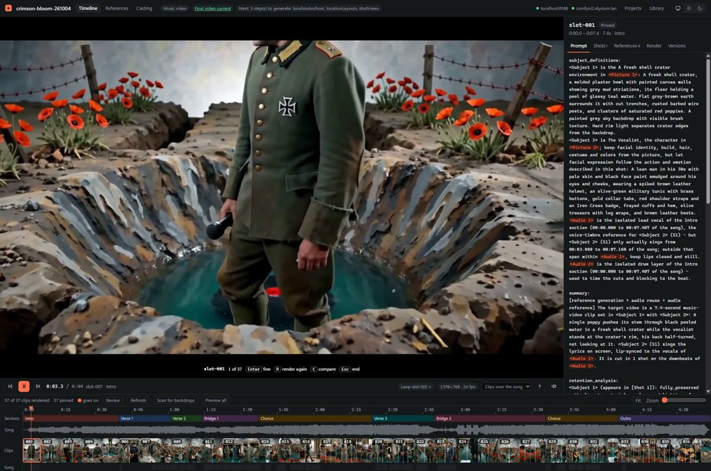

**Review** spielt die markierten Clips nacheinander in Schleife ab. Ist nichts markiert, nimmt es die auffälligen, sonst alle.

| Taste | |
|---|---|
| `Enter` | passt, nächster Clip |
| `R` | neu rendern: merken, nächster Clip |
| `←` | zurück |
| `C` | mit der älteren Fassung vergleichen |
| `Esc` | Review beenden |

Am Ende bleiben genau die mit `R` gemerkten Clips markiert, und die Seite fragt, ob sie gerendert werden sollen.

## Einen Lauf verfolgen oder stoppen

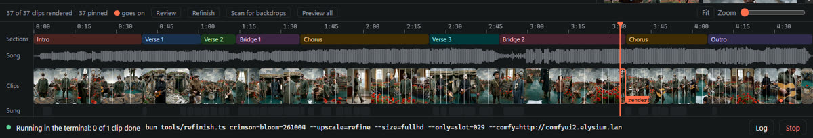

Am unteren Rand steht, was gerade läuft und wie viele Clips fertig sind. **Log** zeigt die Ausgabe der CLI, **Stop** beendet den Lauf. Fertige Dateien bleiben, und Jobs, die schon auf einem Server liegen, nimmt der nächste Lauf wieder auf.

**Wenn etwas schiefgeht:** Bei bekannten Fehlern steht über der Timeline in Klartext, was passiert ist und was zu tun ist, daneben **Repeat**. Andere Fehler zeigt das **Log**. Der häufigste Fall ist `out of memory`: Dann nimmst du einen anderen Server oder renderst kürzer oder kleiner, statt denselben Job noch einmal zu schicken.

## Referenzbilder ändern

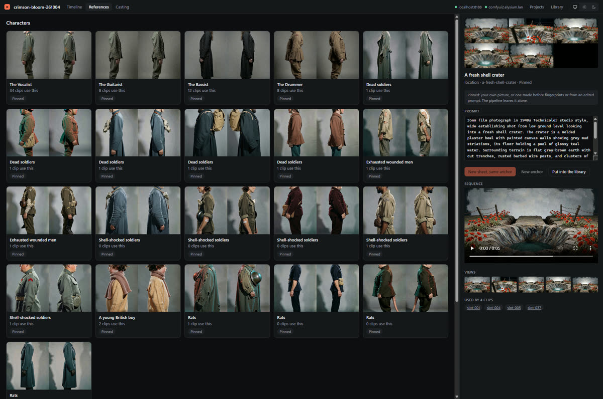

Unter **References** liegen alle Personen, Orte und Requisiten. Rechts stehen Prompt, Ansichten, ältere Fassungen und die Clips, die das Bild benutzen.

- **New sheet, same anchor**: dieselbe Person, andere Ansichten.
- **New anchor**: eine andere Person oder ein anderer Ort, alles danach wird neu.
- **Prompt ändern** und dann rendern: Das Bild bleibt danach gepinnt, der Prompt im Plan bleibt, wie er war.
- **Make current** holt eine ältere Fassung zurück.

Bei einem gepinnten Bild sind die Render-Knöpfe gesperrt. Clips, die das Bild benutzen, werden danach stale, aber nicht von selbst neu gerendert: Das entscheidest du auf der Timeline.

## Besetzung und Bibliothek

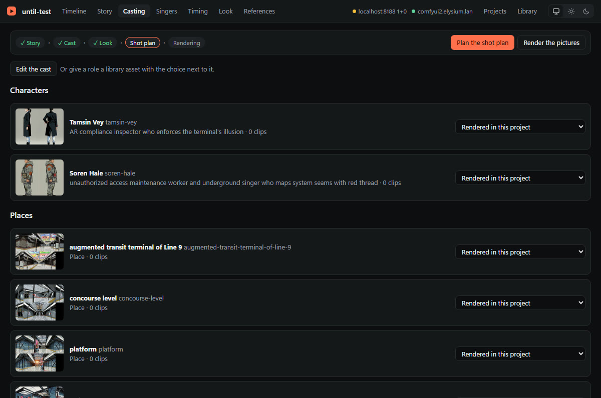

**Casting** zeigt jede Rolle und jeden Ort mit einer Auswahl: **Rendered in this project** oder ein Asset aus der Bibliothek. Eine Änderung schreibt nur einen Eintrag in `casting.json`. Wirksam wird sie mit dem nächsten Planlauf (**Plan now**). Der Dialog davor nennt, welche Schritte aus den alten Texten der Rolle geplant waren und jetzt neu geplant werden. Die betroffenen Clips werden dann stale, gerendert wird nichts von selbst.

**Change the cast** ändert den Cast selbst, ganz ohne Bibliothek: Name, Rolle in der Story und Requisite jeder Figur, die Namen der Orte. Beim Musikvideo kannst du Figuren und Orte auch hinzufügen und entfernen: **Add a character** und **Add a place** stehen über den Listen, **Remove** auf der Karte jeder Rolle. **Add** öffnet den Cast zum Bearbeiten, mit der neuen Figur oder dem neuen Ort schon drin. **Remove** bleibt auf der Liste: Die Karte wird als „Out of the cast when saved“ markiert, **Put back** auf ihr holt die Rolle zurück. Eine Leiste unten zählt, wer wegfällt, und speichert alle Streichungen auf einmal (**Save the cast**) oder verwirft sie (**Discard**). So streichst du viele Rollen in einem Rutsch und speicherst einmal. Im Formular von **Change the cast** steht, wer beim Speichern wegfällt, über dem Knopf, mit **Put back** daneben. Beim Film legt das Drehbuch fest, wer vorkommt (#589): Dort änderst du mit **Edit the roles and places** Name, Rolle, Aussehen und Stimme. Die Ids bleiben, eine umbenannte Figur behält also ihre Bilder und ihren Eintrag in `casting.json`.

**Save the cast** nennt vorher, was aus dem alten Cast geplant war und wegfällt: die Looks, beim Musikvideo auch die Sängerwahl, später die Beats und Einstellungen. Der nächste Planlauf macht es neu, nur mit dem Sprachmodell. Beim Musikvideo werden dabei nur die Looks der neuen oder geänderten Figuren und Orte neu geschrieben, alle anderen behalten ihre. Nach dem Speichern fragt die Seite nach: Bei einer umbenannten Figur setzt **Put them in** den neuen Namen in die Story (als ganzes Wort, auch Vor- oder Nachname allein). Kam jemand dazu oder fiel weg, bietet sie an, die Story für die neue Besetzung erzählen zu lassen (siehe oben).

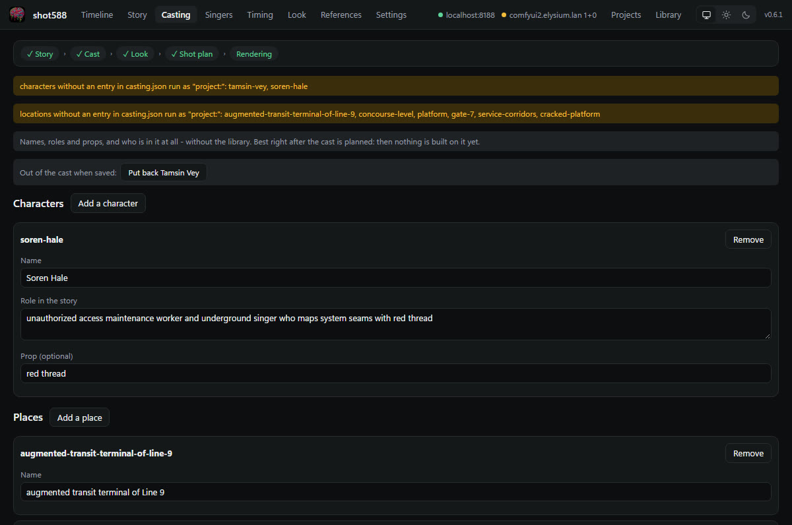

**Library** (oben rechts) zeigt alle Assets und wo sie benutzt werden. **New asset from a picture** legt eines aus einem Bild an. Aus einem Projekt heraus geht es unter **References** mit **Put into the library**. Ein vorhandenes Asset wird dabei nie überschrieben.

## Wer welche Zeile singt

**Singers** (nur bei Musikvideos, in denen jemand singt) listet jede gesungene Zeile, nach Songteilen gruppiert. Hinter jeder Zeile stehen die Sänger als Schalter: Einer singt sie allein, mehrere singen sie zusammen (Duett, Chor). **All of these** schaltet einen Sänger für einen ganzen Songteil. Mit **Add a singer from the cast…** kommt jemand aus dem Cast dazu, der bisher nicht singt. Der Knopf ▶ (oder Leertaste) spielt die Zeile aus dem Vocals-Stem: So hört man, ob eine Frauen- oder Männerstimme singt. Auf der Timeline führt **Change singers** im Tab Shots zur ersten Zeile des Clips.

**Wechselt der Sänger mitten in der Zeile**, klickst du zwischen die beiden Wörter: Dort beginnt ein neuer Teil. Jeder Teil bekommt eigene Sänger-Schalter und einen eigenen ▶. Die Wörter sind in der Farbe ihres Sängers unterstrichen. Ein Klick auf die Trennstelle nimmt sie zurück. Zwei Teile mit denselben Sängern werden beim Speichern wieder einer. Die Trennstelle sitzt auf den Wortzeiten aus dem Abgleich mit dem Transkript. Bei einer Zeile, die dort kaum gefunden wurde, sind sie nur geschätzt; die Seite sagt das, dann hilft ▶ pro Teil.

Tasten auf einer Zeile: **1** bis **9** schaltet den Sänger mit dieser Nummer (bei einer geteilten Zeile im gewählten Teil), **← →** wählt den Teil, **↑ ↓** geht zur nächsten Zeile, **Leertaste** spielt die Zeile oder den gewählten Teil.

Rechts steht, was das Speichern auslöst: Die Beats, in denen eine geänderte Zeile gesungen wird, verlieren ihren Shot-Plan. Ihre Clips werden stale. Steht ein Sänger noch nicht in so einem Beat, wird er hinzugefügt, und der Beat wird ohne seinen Grundriss neu inszeniert. **Save and plan** startet danach den Planlauf. Er fragt das Sprachmodell nur nach diesen Beats, alle anderen Beats und die Story bleiben, gerendert wird nichts. `bun run status` und `--dry-run` nennen die Beats ohne Plan.

Die Zuordnung steht in `project.json` (Schritt `singing`). Sie bleibt, bis sich `lyrics.txt` oder `singers` in `config.json` ändern oder `--redo=singing` das Modell neu fragt.

**Im Terminal:** `bun run singers <id>` listet die Zeilen, nummeriert ab 1. `bun run singers <id> --line=12:mara,ben` lässt Zeile 12 von Mara und Ben singen. Für mehr auf einmal schreibt `--json > singers.json` die Zeilen in eine Datei. Du änderst sie, auch Wechsel mitten in der Zeile als `parts`, und gibst sie mit `--set=singers.json` zurück. Danach nennt der Befehl die neu zu planenden Beats und den Planlauf.

## Wann die Lyrics gesungen werden

**Timing** (bei Musikvideos mit abgeglichenen Lyrics) zeigt oben die Wellenform des Vocals-Stems um eine Zeile, darüber ihre Wörter als Kästen, darunter alle Zeilen. **Estimated** filtert die Zeilen, die der Abgleich mit dem Transkript kaum gefunden hat: Ihre Zeiten sind nur über die Zeile verteilt und können Sekunden danebenliegen.

- Ein Wort ziehen verschiebt es, seine Ränder ziehen ändert Anfang oder Ende. Stößt es an ein Nachbarwort, gibt dieses nach.
- Der Balken über den Wörtern verschiebt die ganze Zeile. **← →** verschiebt sie um 0,05 s, mit Shift um 0,5 s. **Tab** wählt ein Wort, dann gelten die Pfeile für das Wort, **Esc** wieder für die Zeile.
- **Leertaste** spielt die Zeile oder das gewählte Wort, ein Doppelklick ein Wort, ein Klick in die Wellenform spielt ab dort. **Strg+Mausrad** oder **+ / −** zoomt, **Strg+Z** macht rückgängig.
- Gestrichelte Linien sind die Schnitte zwischen den Clips. Fällt ein Schnitt in ein Wort, wird das Wort rot umrandet und die Seite warnt.

**Save** behält die Schnitte: Die Vocals jedes Clips werden aus den neuen Zeiten neu berechnet, nur Beats mit geänderten Clips verlieren ihren Shot-Plan. **Save and plan** plant sie gleich neu. **Save and cut the song again…** schneidet den Song um die neuen Zeiten neu (`--redo=timeline`) und plant dabei jeden Shot neu, das dauert. Verschobene Zeilen gelten als von Hand gesetzt und nicht mehr als geschätzt. Die Zeiten stehen in `project.json` (`lyricsTiming`), bis sich `lyrics.txt` ändert oder `--redo=lyricsTiming` neu abgleicht.

**Im Terminal:** `bun run timing <id>` listet jede Zeile mit Anfang und Ende. `--json > timing.json` schreibt die Wortzeiten in eine Datei. Du verschiebst `start` und `end` und gibst sie mit `--set=timing.json` zurück. Unverändert zurückgegebene Zeilen zählen nicht als geändert. Fällt danach ein Schnitt in ein Wort, sagt der Befehl das und nennt `--redo=timeline`.

**Den Song in die Bibliothek:** **Put the song into the library…** kopiert den Song, die Lyrics, die sechs Stems, die Analyse, das Transkript und das gespeicherte Timing in die Bibliothek (`library/songs/<id>/`), mit jeder von Hand gesetzten Zeile. Erst speichern: Der Knopf ist gesperrt, solange verschobene Zeilen ungespeichert sind. Ein neues Projekt nimmt den Song mit `bun run init` (die Songs der Bibliothek stehen dort zuerst) oder `bun run import-song <id> <song>` und fängt bei der Story an: Am Song wird nichts mehr neu gemacht. Jedes Projekt bekommt eine Kopie, eine spätere Änderung am Timing ändert weder die Bibliothek noch andere Projekte. Ein Song, den die Bibliothek schon hat, wird nie überschrieben. Im Terminal: `bun run export-song <id> [--as=<song-id>] [--name=<name>]`.

## Changing the settings of a project

The **Settings** page holds the render settings of the project, that is, what is otherwise in its `config.json`: the **Video workflow** (for example `h3-ref2video-prism-2pass` instead of `h3-ref2video-2pass`), the image and sheet workflows, the size of video and pictures, the aspect ratio, the context frames, the seed, the retries and the frame rate of the final video. Each setting says what it does and what its default is; **Use the default** goes back to the default, **Undo** to what the project had.

1. **Change** what you need. A changed setting has a coloured bar on its left.
2. Click **Save**. The question says what changes and **how many rendered clips and pictures that makes stale**. The workflow, the size and the aspect ratio are part of what a clip is made from: when one of them changes, the clip counts as *stale*. Other settings, such as the retries or the frame rate of the final video, make nothing stale.
3. **Nothing is rendered** by saving. The timeline then shows which clips are stale, and you render them when you want to.

A wrong value is refused, in the same words as when a run starts. A very high value is only noted, never capped. While a run is going on nothing is written: wait until it is done.

**In the terminal:** `bun run config <id>` shows the settings, `--set=videoWorkflow=h3-ref2video-prism-2pass` changes one (repeatable), `--unset=seed` takes one out of the file. For a film add `--film`. Other keys of `config.json`, such as the singers, are changed on the page they belong to, or by hand.

## Ein älteres Projekt aufwerten

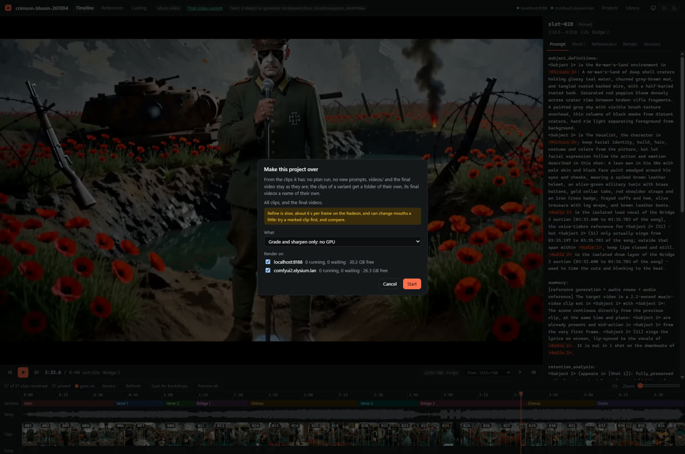

**Refinish** über der Timeline macht ein fertiges Projekt größer, flüssiger und farblich wie die neueren, aus den vorhandenen Clips. Es läuft kein Plan und kein Prompt ändert sich. `videos/` und das fertige Video bleiben, wie sie sind: Jede Variante bekommt einen eigenen Ordner und eigene Dateinamen.

| Auswahl | Was passiert | Aufwand |
|---|---|---|
| **Grade and sharpen only** | Farbe und Schärfe | keine GPU |
| **48 fps, grade and sharpen** | dazu Zwischenbilder | etwa 15 Minuten für 37 Clips auf der Radeon |
| **Full HD by a refine pass, 48 fps, grade and sharpen** | dazu der zweite Render-Pass auf jedem Clip | etwa 6 s pro Frame auf der Radeon, also viele Stunden für ein ganzes Projekt |
| **Say it one by one** | alles einzeln wählen | |

So gehst du sinnvoll vor:

1. **Einen oder zwei Clips markieren**, am besten einen mit Gesang. Mit Markierung entstehen nur die größeren Clips, kein fertiges Video. Das lohnt sich also nur mit einer Variante, die vergrößert: Ohne Vergrößerung entsteht dabei gar nichts.
2. **Refinish** öffnen und die Variante starten.
3. Im Reiter **Render** unter **Larger versions** auf **Compare with the original** klicken und **mit Ton** ansehen. Refine kann Münder leicht verändern. Prüfe auch Clips mit *Goes on*, weil jeder Clip für sich bearbeitet wird und es am Übergang springen kann.
4. Passt es, ohne Markierung für das ganze Projekt starten. Fertige Clips werden nicht noch einmal gemacht.

Die Varianten erscheinen in der Auswahl neben der Abspielzeit als **Clips: refine-fullhd** und die fertigen Videos als **Refinish refine-fullhd 48 fps finished**. Die Optionen für das Terminal stehen in der [README](../README.md#making-an-older-project-over).

## Before publishing: the AI marker

**AI marker** under the timeline (there once a final video exists) puts a marker over a finished video, as a new video next to it: `<name>-labeled.mp4`. The video it starts from stays as it is.

1. **From**: which video. The finished one is chosen when there is one.
2. **Marker**: an EU icon for AI-generated content (*AI GENERATED*, *AI MODIFIED* or *AI*, white or black, opaque or 50 % transparent), or *A PNG of my own* with its path.
3. **When**: at the start only (enough for a music video or a film, an artistic work), at the start and again at an interval, or the whole time. Then the corner, the height and the margin.
4. **Keep these settings for this project** writes them into `config.json`, so the next time the form opens with them.

It runs on this machine, no GPU, in about the time the video plays. The new video appears among the videos of the timeline as *… + AI label*. Why and when such a marker is needed: [docs/postwork.md](postwork.md).

**In the terminal:** `bun run label <id>` with the same choices as options (`--marker=`, `--mode=`, `--corner=`, …).

## Tasten

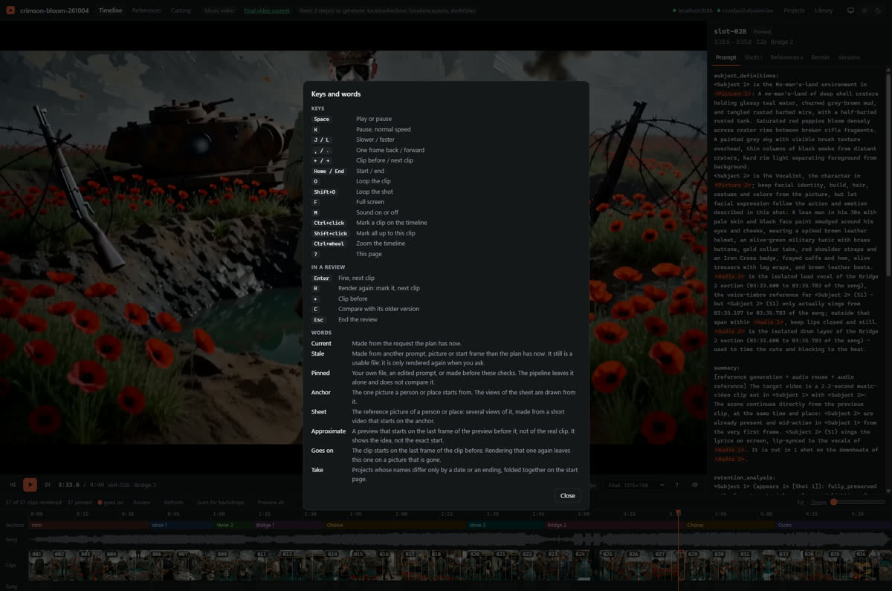

`?` zeigt dieses Fenster auf jeder Timeline.
